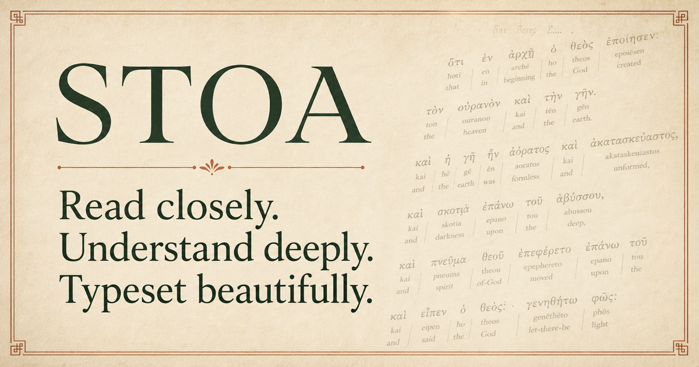
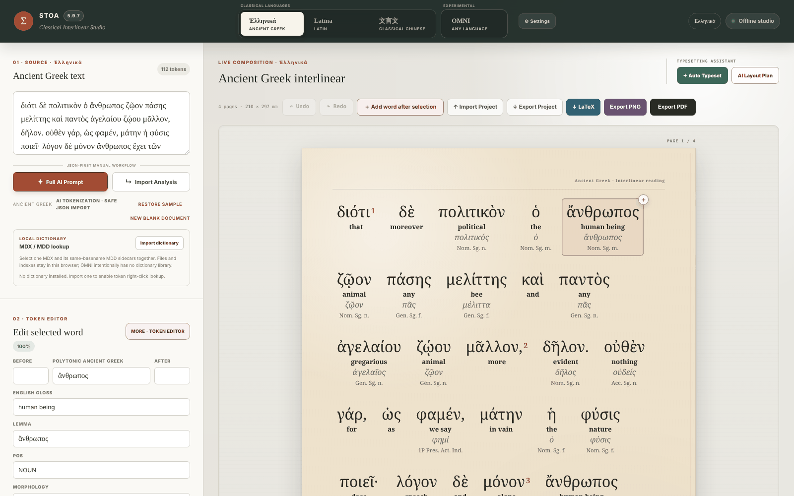
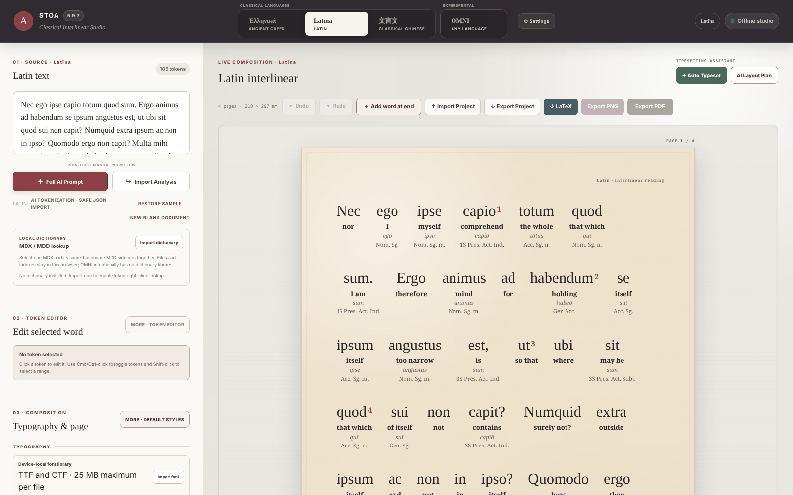
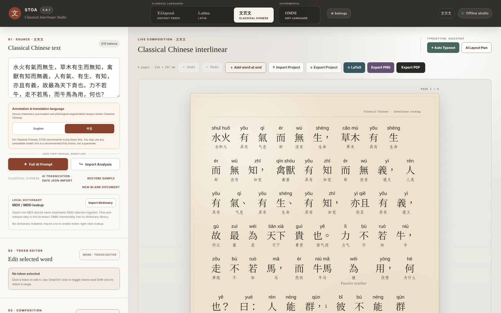

<p align="center">
  
</p>

<h1 align="center">STOA</h1>

<p align="center">
  <strong>An interlinear reading and typesetting studio for Ancient Greek, Latin and Classical Chinese.</strong>
</p>

<p align="center">
  <a href="https://github.com/SameDestination/stoa-classical-language-tool/actions/workflows/ci.yml"></a>
  <a href="LICENSE"></a>
  
  
</p>

<p align="center">
  <a href="#download">Download</a> ·
  <a href="https://stoa-interlinear-studio.goldnerbaum.chatgpt.site">Website</a> ·
  <a href="#quick-start">Quick start</a> ·
  <a href="CONTRIBUTING.md">Contributing</a> ·
  <a href="README.zh-CN.md">中文说明</a>
</p>

STOA turns a classical text into an interlinear reading edition. Each word is
kept together with its translation, lemma, part of speech and morphology, and
stays one editable unit across line breaks and pages. An AI model drafts the
analysis, you check and correct every word, and STOA typesets the result as a
searchable PDF, PNG pages or LaTeX.

It is built for students, teachers, independent readers and scholars who need
more than a translation box, and it is local-first: your texts stay on your
device.

<p align="center">
  
</p>

## Contents

- [Features](#features)
- [Languages](#languages)
- [Download](#download)
- [Quick start](#quick-start)
- [AI analysis and privacy](#ai-analysis-and-privacy)
- [Build from source](#build-from-source)
- [Project structure](#project-structure)
- [The project file format](#the-project-file-format)
- [Contributing](#contributing)
- [License](#license)
- [Citing STOA](#citing-stoa)

## Features

- **Word-level interlinear editing.** Every token holds a surface form,
  punctuation before and after, a gloss, a lemma, a part of speech
  (Universal Dependencies tags) and morphology. Select one word or a range and
  edit it; nothing breaks the interlinear unit.
- **AI-assisted analysis you stay in control of.** STOA builds a detailed,
  language-specific prompt and imports the model's structured JSON answer.
  Imported analyses are validated and every field remains editable.
- **Publication typesetting.** Paper size, margins, fonts, sizes, colours,
  word spacing, line and paragraph breaks, headers, footers and notes.
  *Auto Typeset* and *AI Layout Plan* help balance the page.
- **Export.** Searchable vector PDF, PNG pages rendered from that PDF, and
  LaTeX source.
- **Dictionary lookup.** Import your own MDict (`.mdx`/`.mdd`) dictionaries,
  such as LSJ for Greek, and look up any word from the page. Dictionaries stay
  on your device and are never bundled or uploaded.
- **Portable projects.** Save the whole document, including tokens, styles,
  paper settings, breaks and translations, as one `.stoa.json` file and open it
  on another computer.
- **Bundled fonts.** Polytonic Greek, Latin and six Chinese typefaces are
  included. Times New Roman is loaded from your own device, never
  redistributed.

## Languages

| Language | What STOA adds |
| --- | --- |
| **Ancient Greek** | Polytonic text, Greek morphology conventions, lemma per word |
| **Latin** | Latin inflection and abbreviation conventions for prose and verse |
| **Classical Chinese** | Hanyu Pinyin above each word, glosses in English or Chinese, Chinese typefaces |
| **OMNI** *(experimental)* | Any other language. STOA detects the language and applies detailed morphology rules for 22 languages, among them Modern Greek, German, Russian, Polish, Spanish, French, Italian and Portuguese. Scripts the vector PDF engine cannot set are exported as an image-based PDF. Check OMNI results carefully before relying on them. |

<table>
  <tr>
    <td></td>
    <td></td>
  </tr>
  <tr>
    <td align="center">Latin</td>
    <td align="center">Classical Chinese with Pinyin</td>
  </tr>
</table>

## Download

STOA comes in three editions. All three contain the same editor. Download
them from the
[latest release](https://github.com/SameDestination/stoa-classical-language-tool/releases/latest).

| Edition | Best for | Requirements | File |
| --- | --- | --- | --- |
| **Desktop for macOS** | Daily use, native Open/Save | Apple Silicon Mac, macOS 13 or later | `STOA-macOS-arm64.dmg` |
| **Desktop for Windows** | Daily use, native Open/Save | 64-bit Windows 10 or later | `STOA-Windows-x64.msi` |
| **Portable** | Running from a folder or USB stick without installing | Any desktop browser and Python 3 | `STOA-<version>-Portable.zip` |

Each release lists the SHA-256 checksum of every file. Check a download with
`shasum -a 256 <file>` on macOS or `Get-FileHash <file>` in Windows
PowerShell. Packages for STOA 5.9.7 and earlier are no longer distributed;
see [docs/historical-releases.md](docs/historical-releases.md).

### Installing

The installers are not yet signed by Apple or Microsoft, so both systems warn
you the first time.

**macOS.** Open the DMG and drag STOA into Applications. If macOS says the app
cannot be opened, open **System Settings → Privacy & Security** and click
**Open Anyway** next to the STOA message. Alternatively, run this once in
Terminal:

```sh
xattr -dr com.apple.quarantine /Applications/STOA.app
```

**Windows.** Run the MSI. If SmartScreen shows "Windows protected your PC",
click **More info → Run anyway**. The installer lets you choose a folder,
installs for the current user only, adds Start menu and desktop shortcuts and
opens `.stoa` files with STOA. If anything goes wrong during installation,
please [open an issue](https://github.com/SameDestination/stoa-classical-language-tool/issues/new/choose).

**Portable.** Unzip the folder and double-click `Start-STOA-macOS.command` on
macOS or `Start-STOA-Windows.bat` on Windows. A small local server starts and
STOA opens in your browser at `http://127.0.0.1:8765/`. Keep the launcher
window open while you work. Do not open `index.html` directly. The Portable
edition starts fresh each time, so use **Export Project** to save your work.

## Quick start

1. **Choose a language** at the top of the window. Each language opens with a
   sample text you can explore; **New blank document** starts from scratch.
2. **Enter your text** in *01 · Source*.
3. **Analyse it.** Click **Full AI Prompt**, paste the prompt into the AI chat
   of your choice, copy its JSON answer, and click **Import Analysis**. For
   long texts, **Guided chunk analysis** splits the work into smaller prompts.
4. **Check and correct each word.** Click a word on the page to edit its
   gloss, lemma, part of speech and morphology in *02 · Token Editor*.
   Ctrl-click (⌘-click on a Mac) selects several words; Shift-click selects a
   range.
5. **Compose the page** in *03 · Composition*: paper, fonts, spacing, breaks
   and translation.
6. **Export** a PDF, PNG pages or LaTeX, and save the project (**Save** in the
   Desktop edition, **Export Project** elsewhere) to continue later.

## AI analysis and privacy

STOA has no accounts and never uploads your texts to a STOA server.

- STOA does not connect to AI services and never asks for an API key. You
  copy the prompt to an AI service yourself, so you decide exactly what is
  shared.
- Your documents, imported fonts and dictionaries stay on your device.

When you use an AI service, that service's own terms and privacy policy
apply. AI models make mistakes, especially with rare forms, so treat every
analysis as a draft to check. For security questions see
[SECURITY.md](SECURITY.md).

## Build from source

You need [Node.js](https://nodejs.org/) 22.13 or newer and Git.

```sh
git clone https://github.com/SameDestination/stoa-classical-language-tool.git
cd stoa-classical-language-tool
npm ci
npm run dev:web          # editor at http://127.0.0.1:5173
```

| Command | Result |
| --- | --- |
| `npm run dev:web` | Editor with hot reload |
| `npm run desktop` | Editor inside the Electron desktop shell |
| `npm run build:portable` | Portable edition in `outputs/STOA-Portable/` |
| `npm run build:desktop:installers` | macOS DMG and Windows MSI (run on macOS; see [desktop/README.md](desktop/README.md#packaging)) |
| `npm run check` | Typecheck, lint and the full test suite |

[CONTRIBUTING.md](CONTRIBUTING.md) lists every command and explains how to
run individual tests.

## Project structure

```text
app/
  stoa-studio.tsx        The editor: one renderer shared by every edition
  lib/                   Language rules, AI prompts and JSON import, layout, PDF/PNG/LaTeX export, project format
  developer-defaults/    Bundled sample projects and default settings (single source)
  page.tsx, privacy/, …  The marketing website
desktop/                 Electron shell: main process, preload bridges, installer builders
standalone/              Vite entry for the Web and Portable editions, Portable launcher
public/                  Fonts, PDF.js worker, website images
tests/                   Unit and contract tests (Node test runner)
docs/                    Release checklist, release reports, historical archive index
scripts/                 Portable optimisation and desktop QA scripts
worker/, build/          Cloudflare Worker entry and build plugin for the website
```

The Web, Portable and Desktop editions all bundle the same editor from `app/`.
The desktop shell adds native file handling behind a narrow, sandboxed
bridge; see [desktop/README.md](desktop/README.md) for its
security model.

## The project file format

A STOA project is a single JSON document, saved as `.stoa.json` by the Web and
Portable editions and as `.stoa` by the Desktop edition. The contents are
identical: the Desktop edition opens both, and a `.stoa` file opens in the Web
or Portable edition after you rename it to end in `.stoa.json`. The format carries its own schema version (currently 6),
separate from the application version, and older projects are migrated
automatically when opened. The schema is defined in
[`app/lib/stoa-project.ts`](app/lib/stoa-project.ts).

## Contributing

Bug reports, corrections to language data, documentation and code are all
welcome. Read [CONTRIBUTING.md](CONTRIBUTING.md) to get started, and use the
[issue forms](https://github.com/SameDestination/stoa-classical-language-tool/issues/new/choose)
to report problems. Contributors sign a short
[Contributor License Agreement](CLA.md) on their first pull request. Everyone
taking part is expected to follow the [Code of Conduct](CODE_OF_CONDUCT.md).

Please report security vulnerabilities privately, as described in
[SECURITY.md](SECURITY.md). Changes between versions are listed in
[CHANGELOG.md](CHANGELOG.md).

## License

STOA is free software: you can redistribute it and/or modify it under the
terms of the [GNU General Public License](LICENSE) as published by the Free
Software Foundation, either version 3 of the License, or (at your option) any
later version (`GPL-3.0-or-later`). If you distribute a modified version, you
must release its source under the same terms.

STOA is distributed in the hope that it will be useful, but WITHOUT ANY
WARRANTY; without even the implied warranty of MERCHANTABILITY or FITNESS FOR
A PARTICULAR PURPOSE. See the GNU General Public License for more details.

Bundled fonts and third-party code keep their own licenses, listed in
[THIRD_PARTY_NOTICES.md](THIRD_PARTY_NOTICES.md).

## Citing STOA

If STOA helps your research or teaching, please cite it. GitHub's **Cite this
repository** button (from [CITATION.cff](CITATION.cff)) gives APA and BibTeX
formats.

## Acknowledgements

STOA builds on [Electron](https://www.electronjs.org/),
[React](https://react.dev/), [Vite](https://vite.dev/),
[PDF.js](https://mozilla.github.io/pdf.js/), [PDFKit](https://pdfkit.org/),
[html2canvas](https://html2canvas.hertzen.com/),
[js-mdict](https://github.com/tonyzhou1890/js-mdict) and the Liberation, Noto,
Source Han Serif and Fandol font families. See
[THIRD_PARTY_NOTICES.md](THIRD_PARTY_NOTICES.md) for details.
