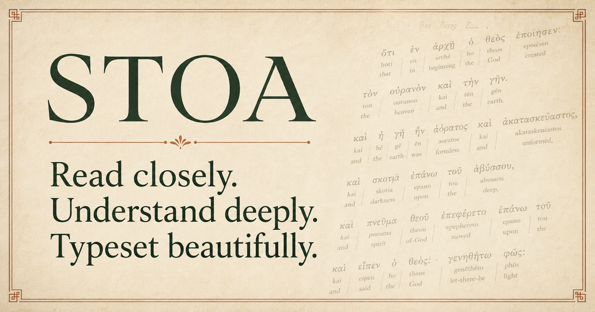
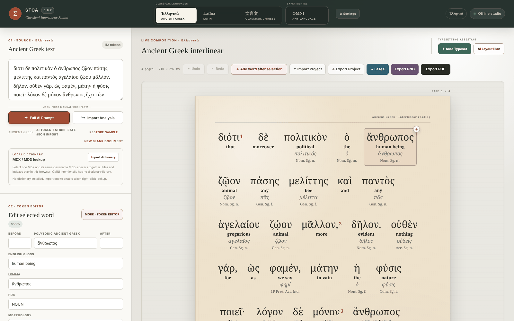
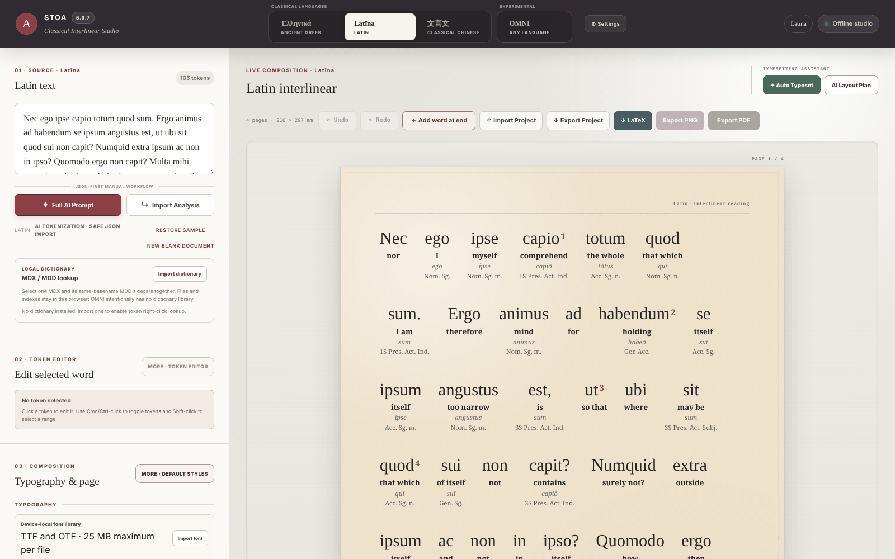
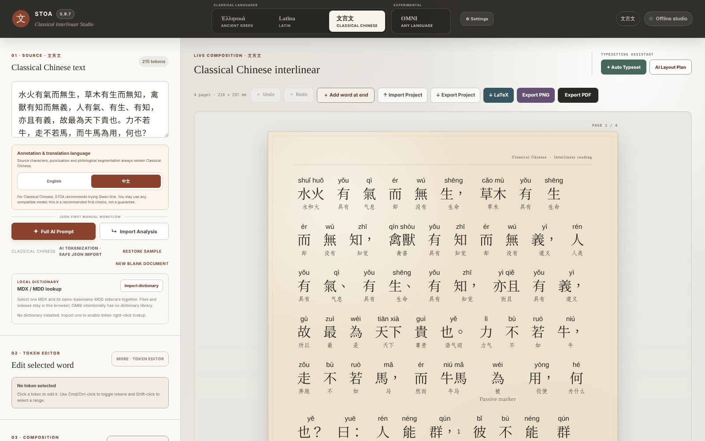

<p align="center">
  
</p>

<h1 align="center">STOA</h1>

<p align="center">
  <strong>面向古希腊语、拉丁语与文言文的逐词对照阅读与排版工具。</strong>
</p>

<p align="center">
  <a href="https://github.com/SameDestination/stoa-classical-language-tool/actions/workflows/ci.yml"></a>
  <a href="LICENSE"></a>
  
  
</p>

<p align="center">
  <a href="#下载">下载</a> ·
  <a href="https://stoa-interlinear-studio.goldnerbaum.chatgpt.site">网站</a> ·
  <a href="#快速上手">快速上手</a> ·
  <a href="CONTRIBUTING.md">参与贡献</a> ·
  <a href="README.md">English</a>
</p>

STOA 把一段古典文本制作成逐词对照（interlinear）的阅读版本。每个词都与它的释义、词元（lemma）、词性和形态信息放在一起，跨行、跨页时仍是一个可编辑的整体。AI 模型先给出分析草稿，你逐词检查和修改，STOA 再把结果排版为可检索文字的 PDF、PNG 页面或 LaTeX。

STOA 适合学生、教师、自学者和研究者，满足一般翻译框做不到的细读需求。它以本地为先：你的文本保存在你自己的设备上。

<p align="center">
  
</p>

> 本文是 [English README](README.md) 的中文版。两者内容不一致时，以英文版为准。程序界面目前为英文。

## 目录

- [功能](#功能)
- [语言](#语言)
- [下载](#下载)
- [快速上手](#快速上手)
- [AI 分析与隐私](#ai-分析与隐私)
- [从源代码构建](#从源代码构建)
- [项目结构](#项目结构)
- [项目文件格式](#项目文件格式)
- [参与贡献](#参与贡献)
- [许可证](#许可证)
- [引用 STOA](#引用-stoa)

## 功能

- **逐词对照编辑。** 每个 token 包含词形、前后标点、释义、词元、词性（Universal Dependencies 标签）和形态信息。可以选中一个词或一段范围进行编辑，不会破坏对照结构。
- **由你掌控的 AI 辅助分析。** STOA 生成针对具体语言的详细提示词，并导入模型返回的结构化 JSON。导入的分析会经过校验，每个字段都可以继续修改。
- **出版级排版。** 纸张尺寸、页边距、字体、字号、颜色、词距、换行与分段、页眉、页脚和注释。*Auto Typeset* 和 *AI Layout Plan* 帮助平衡版面。
- **导出。** 可检索文字的矢量 PDF、由该 PDF 渲染的 PNG 页面，以及 LaTeX 源文件。
- **词典查询。** 导入你自己的 MDict 词典（`.mdx`/`.mdd`），例如古希腊语的 LSJ，在页面上直接查词。词典只保存在你的设备上，既不随程序附带，也不会上传。
- **可迁移的项目。** 把整个文档（token、样式、纸张设置、换行和译文）保存为一个 `.stoa.json` 文件，在另一台电脑上打开。
- **内置字体。** 附带多调希腊文字体、拉丁文字体和六款中文字体。Times New Roman 从你自己的设备加载，程序不分发该字体。

## 语言

| 语言 | STOA 提供的支持 |
| --- | --- |
| **古希腊语** | 多调文字、希腊语形态标注规范、逐词词元 |
| **拉丁语** | 适用于散文和诗歌的拉丁语屈折与缩写规范 |
| **文言文** | 每个词上方标注汉语拼音，释义可用英文或中文，配有中文字体 |
| **OMNI**（实验性） | 其他任何语言。STOA 自动识别语言，并为 22 种语言（包括现代希腊语、德语、俄语、波兰语、西班牙语、法语、意大利语和葡萄牙语等）提供详细的形态规则。矢量 PDF 引擎无法排版的文字会导出为图像式 PDF。使用 OMNI 的结果前请仔细核对。 |

<table>
  <tr>
    <td></td>
    <td></td>
  </tr>
  <tr>
    <td align="center">拉丁语</td>
    <td align="center">文言文（带拼音）</td>
  </tr>
</table>

## 下载

STOA 有三个版本，它们使用同一个编辑器。请从[最新发布版本](https://github.com/SameDestination/stoa-classical-language-tool/releases/latest)下载。

| 版本 | 适合 | 系统要求 | 文件 |
| --- | --- | --- | --- |
| **macOS 桌面版** | 日常使用、原生打开/保存 | Apple 芯片 Mac，macOS 13 或更高 | `STOA-macOS-arm64.dmg` |
| **Windows 桌面版** | 日常使用、原生打开/保存 | 64 位 Windows 10 或更高 | `STOA-Windows-x64.msi` |
| **便携版（Portable）** | 免安装，从文件夹或 U 盘运行 | 任意桌面浏览器和 Python 3 | `STOA-<版本号>-Portable.zip` |

每个发布版本都列出了所有文件的 SHA-256 校验值。在 macOS 上用 `shasum -a 256 <文件>`，在 Windows PowerShell 中用 `Get-FileHash <文件>` 核对下载的文件。STOA 5.9.7 及更早版本的安装包已不再提供下载，见 [docs/historical-releases.md](docs/historical-releases.md)。

### 安装

安装包尚未经过 Apple 或 Microsoft 签名，因此第一次打开时系统会发出警告。

**macOS。** 打开 DMG，把 STOA 拖进“应用程序”。如果 macOS 提示无法打开，请前往 **系统设置 → 隐私与安全性**，在 STOA 的提示旁点击 **仍要打开**。也可以在“终端”中运行一次：

```sh
xattr -dr com.apple.quarantine /Applications/STOA.app
```

**Windows。** 运行 MSI。如果 SmartScreen 显示“Windows 已保护你的电脑”，请点击 **更多信息 → 仍要运行**。安装程序可以选择安装文件夹，只为当前用户安装，会添加开始菜单和桌面快捷方式，并用 STOA 打开 `.stoa` 文件。如果安装过程中出现问题，请[提交 issue](https://github.com/SameDestination/stoa-classical-language-tool/issues/new/choose)。

**便携版。** 解压文件夹，在 macOS 上双击 `Start-STOA-macOS.command`，在 Windows 上双击 `Start-STOA-Windows.bat`。一个小型本地服务器会启动，STOA 会在浏览器中打开 `http://127.0.0.1:8765/`。使用期间请保持启动窗口打开，不要直接打开 `index.html`。便携版每次启动都会恢复初始状态，请用 **Export Project** 保存你的工作。详细说明见包内的 `README-使用说明.txt`。

## 快速上手

1. **在窗口顶部选择语言。** 每种语言都附带一份示例文本；点击 **New blank document** 可以从空白文档开始。
2. **在 *01 · Source* 中输入文本。**
3. **进行分析。** 点击 **Full AI Prompt**，把提示词粘贴到你选择的 AI 对话中，复制它返回的 JSON，再点击 **Import Analysis**。长文本可以使用 **Guided chunk analysis**，把工作拆成若干较短的提示词。
4. **逐词检查和修改。** 点击页面上的词，在 *02 · Token Editor* 中修改释义、词元、词性和形态。按住 Ctrl（Mac 上为 ⌘）点击可选择多个词，按住 Shift 点击可选择一段范围。
5. **在 *03 · Composition* 中设置版面：** 纸张、字体、间距、换行和译文。
6. **导出** PDF、PNG 页面或 LaTeX，并保存项目（桌面版用 **Save**，其他版本用 **Export Project**），以便日后继续。

## AI 分析与隐私

STOA 没有账户系统，也从不把你的文本上传到 STOA 的服务器。

- STOA 不连接任何 AI 服务，也从不索要 API 密钥。由你自己把提示词复制到 AI 服务中，因此分享哪些内容完全由你决定。
- 你的文档、导入的字体和词典都保存在你的设备上。

使用 AI 服务时，适用该服务自身的条款和隐私政策。AI 模型会出错，尤其是遇到罕见词形时，因此请把每一份分析都当作需要核对的草稿。安全问题请参阅 [SECURITY.md](SECURITY.md)。

## 从源代码构建

需要 [Node.js](https://nodejs.org/) 22.13 或更高版本，以及 Git。

```sh
git clone https://github.com/SameDestination/stoa-classical-language-tool.git
cd stoa-classical-language-tool
npm ci
npm run dev:web          # 编辑器地址：http://127.0.0.1:5173
```

| 命令 | 结果 |
| --- | --- |
| `npm run dev:web` | 支持热更新的编辑器 |
| `npm run desktop` | 在 Electron 桌面外壳中运行编辑器 |
| `npm run build:portable` | 在 `outputs/STOA-Portable/` 生成便携版 |
| `npm run build:desktop:installers` | 生成 macOS DMG 和 Windows MSI（需在 macOS 上运行，见 [desktop/README.md](desktop/README.md#packaging)） |
| `npm run check` | 类型检查、代码检查和完整测试 |

[CONTRIBUTING.md](CONTRIBUTING.md) 列出了所有命令，并说明如何运行单个测试。

## 项目结构

```text
app/
  stoa-studio.tsx        编辑器：所有版本共用的同一个渲染层
  lib/                   语言规则、AI 提示词与 JSON 导入、版式、PDF/PNG/LaTeX 导出、项目格式
  developer-defaults/    内置示例项目和默认设置（唯一来源）
  page.tsx, privacy/, …  宣传网站
desktop/                 Electron 外壳：主进程、preload 桥接、安装包构建脚本
standalone/              网页版和便携版的 Vite 入口、便携版启动器
public/                  字体、PDF.js worker、网站图片
tests/                   单元测试和契约测试（Node 测试运行器）
docs/                    发布清单、发布报告、历史存档索引
scripts/                 便携版优化和桌面版 QA 脚本
worker/, build/          网站的 Cloudflare Worker 入口和构建插件
```

网页版、便携版和桌面版都打包 `app/` 中的同一个编辑器。桌面外壳通过一个受限的沙盒桥接层提供原生文件操作，安全模型见 [desktop/README.md](desktop/README.md)。

## 项目文件格式

STOA 项目是一个 JSON 文档。网页版和便携版保存为 `.stoa.json`，桌面版保存为 `.stoa`，两者内容相同：桌面版可以打开这两种文件；把 `.stoa` 文件重命名为以 `.stoa.json` 结尾后，也可以在网页版或便携版中打开。文件格式有独立于程序版本的结构版本号（目前为 6），打开旧项目时会自动迁移。格式定义见 [`app/lib/stoa-project.ts`](app/lib/stoa-project.ts)。

## 参与贡献

欢迎报告问题、修正语言数据、改进文档和提交代码。请先阅读 [CONTRIBUTING.md](CONTRIBUTING.md)（英文），并使用 [issue 表单](https://github.com/SameDestination/stoa-classical-language-tool/issues/new/choose)报告问题。贡献者在第一次提交 pull request 时需要签署一份简短的[贡献者许可协议（CLA）](CLA.md)。所有参与者都应遵守[行为准则](CODE_OF_CONDUCT.md)。

安全漏洞请按 [SECURITY.md](SECURITY.md) 中的说明私下报告。各版本的变化记录在 [CHANGELOG.md](CHANGELOG.md) 中。

## 许可证

STOA 是自由软件，采用 [GNU 通用公共许可证](LICENSE)第 3 版或（由你选择）任何更高版本授权（`GPL-3.0-or-later`）。你可以使用、研究、分享和修改它；如果分发修改后的版本，必须以相同条款公开其源代码。STOA 不提供任何担保，包括适销性或特定用途适用性的默示担保，详见 GNU 通用公共许可证。

内置字体和第三方代码保留各自的许可证，列在 [THIRD_PARTY_NOTICES.md](THIRD_PARTY_NOTICES.md) 中。

## 引用 STOA

如果 STOA 对你的研究或教学有帮助，欢迎引用。GitHub 页面上的 **Cite this repository** 按钮（基于 [CITATION.cff](CITATION.cff)）提供 APA 和 BibTeX 格式。

## 致谢

STOA 基于 [Electron](https://www.electronjs.org/)、[React](https://react.dev/)、[Vite](https://vite.dev/)、[PDF.js](https://mozilla.github.io/pdf.js/)、[PDFKit](https://pdfkit.org/)、[html2canvas](https://html2canvas.hertzen.com/)、[js-mdict](https://github.com/tonyzhou1890/js-mdict)，以及 Liberation、Noto、思源宋体（Source Han Serif）和 Fandol 字体家族。详见 [THIRD_PARTY_NOTICES.md](THIRD_PARTY_NOTICES.md)。
